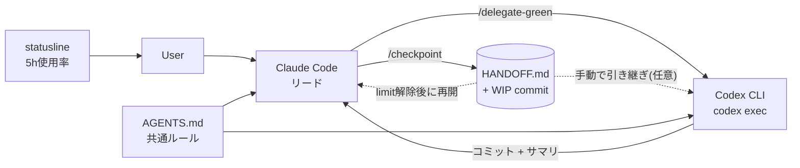

# Claude Code × Codex 協同ワークフロー設計案

- 対象環境: Windows 11 + WSL2 (Ubuntu) / Claude Code (Pro) / Codex CLI (ChatGPT Plus)
- ステータス: ドラフト（未検証項目は「§9 実機確認」を参照）

## 1. 目的と方針

| 項目 | 方針 |
|---|---|
| 役割 | Claude Code = リード（設計・テスト定義・検収）、Codex = ワーカー（実装・機械的作業・レビュー） |
| 委任のトリガー | **人が指示したときのみ**（自動判断しない） |
| 主な委任パターン | TDD: Claude が Red（失敗テスト）→ Codex が Green + Refactor → Claude が検収 |
| limit 対策 | 5h 使用率を可視化し、閾値で手動 `/checkpoint`。**中断→再開**が基本（自動引き継ぎは作らない） |
| 状態の正 | git（WIP コミット）+ `HANDOFF.md`（ツール非依存） |
| 実行形態 | 対話中心、同一ブランチ・逐次実行 |

## 2. 全体構成



## 3. リポジトリ構成

```text
repo/
├── AGENTS.md                      # 共通ルール（正）。Codex が読む。32KiB 以内
├── CLAUDE.md                      # `@AGENTS.md` を import + Claude 固有ルール
├── HANDOFF.md                     # 台帳（git 管理、ツール非依存）
├── .claude/
│   ├── settings.json              # statusLine 設定
│   ├── statusline.sh
│   └── commands/
│       ├── checkpoint.md          # /checkpoint
│       └── delegate-green.md      # /delegate-green
└── .codex-handoff/                # Codex からの結果サマリ置き場（任意で .gitignore）
    └── last-result.md
```

## 4. 共通ルール（AGENTS.md / CLAUDE.md）

`AGENTS.md`（抜粋・テンプレート）:

```markdown
# AGENTS.md
## プロジェクト概要
<1〜3行>

## コマンド
- テスト: `<test command>`
- Lint: `<lint command>`

## 規約
- 変更は最小限。指定ファイル以外は触らない
- テストを弱める・削除する変更は禁止（Green は実装側で達成する）
- シークレット、認証情報、.env を読まない・書かない
- コミットメッセージ: Conventional Commits

## 引き継ぎ
- 作業の前に `HANDOFF.md` を読む
- 作業後、`.codex-handoff/last-result.md` に結果サマリを書く
```

`CLAUDE.md`:

```markdown
@AGENTS.md

## Claude 固有
- 作業の区切りごとに HANDOFF.md の「現在地」を更新する
- Codex に委任するときは /delegate-green を使う
```

## 5. 台帳フォーマット（HANDOFF.md）

```markdown
# HANDOFF
更新: <ISO8601> / 更新者: claude|codex|human / ブランチ: <name> / 直近コミット: <sha>

## ゴール
<一文>

## 現在地
- [x] 完了したこと
- [ ] 次にやること（1つ目が再開点）

## 決定事項
- <決定> — 理由: <理由>

## 制約・触ってはいけない箇所
- <path or 方針>

## 検証コマンド
- `<test command>`

## 未解決・懸念
- <内容>
```

## 6. コマンド仕様

### 6.1 `/checkpoint`（`.claude/commands/checkpoint.md`）

```markdown
---
description: 中断に備えて台帳を更新し WIP コミットを作る
allowed-tools: Bash(git status:*), Bash(git add:*), Bash(git commit:*), Bash(git diff:*), Bash(git log:*), Read, Edit
---
次の手順を実行してください。

1. `git status` と `git diff --stat` で現状を確認する。
2. HANDOFF.md を更新する: 現在地（完了/次にやること。1つ目が再開点）、決定事項とその理由、未解決点、直近コミット。
3. 変更を `git add -A` し、`wip: <要約>` でコミットする（シークレットが含まれていないか diff を確認してから）。
4. 最後に「再開点」を1〜2行で報告する。
```

### 6.2 `/delegate-green`（`.claude/commands/delegate-green.md`）

TDD 委任の型。**テストが受け入れ契約**。

```markdown
---
description: 失敗テスト(Red)を Codex に渡して Green + Refactor を委任する
argument-hint: <対象の説明 / 触ってよいパス>
allowed-tools: Bash(git status:*), Bash(git add:*), Bash(git commit:*), Bash(git diff:*), Bash(git log:*), Bash(codex exec:*), Bash(cat:*), Read
---
引数: $ARGUMENTS

手順:
1. 事前確認: 失敗テスト(Red)が存在し、テストコマンドが失敗することを確認する。無ければ先に Red を作る。
2. `git add -A && git commit -m "test: red for <対象>"` で Red をコミットする（戻れる状態を作る）。
3. 下記テンプレートでタスクを組み、Codex を実行する:

   ```bash
   codex exec -s workspace-write "$(cat <<'EOF'
   <タスク仕様>
   - ゴール: <ゴール>
   - 触ってよいファイル: <paths>
   - 触ってはいけない: テストファイル（変更・削除・skip 禁止）、その他のパス
   - 完了条件: `<test command>` が全て成功
   - 手順: 実装(Green) → リファクタ → テスト再実行
   - 終了時: .codex-handoff/last-result.md に「変更点・実行したテストと結果・未解決点」を書く
   - コミット: `feat: green for <対象>` で1コミットにまとめる
   EOF
   )"
   ```
4. 検収: `git log -1 --stat`、`git diff HEAD~1`、`.codex-handoff/last-result.md` を読み、テストを自分で再実行する。テスト改変の有無、触ってよいパス外の変更を必ず確認する。
5. 不合格なら `codex exec resume --last "<差し戻し指示>"` で追加指示するか、`git reset --hard <Red のコミット>` で戻す（reset は実行前にユーザーへ確認）。
6. 合格なら HANDOFF.md を更新する。
```

> フラグ（`-s`、`resume --last`）は §9 の確認項目。公式プラグイン（codex-plugin-cc）の委任コマンドで sandbox・プロンプトを制御できるなら、そちらへ置き換える。

## 7. limit 可視化（statusline）

`.claude/settings.json`:

```json
{
  "statusLine": {
    "type": "command",
    "command": "bash .claude/statusline.sh"
  }
}
```

`.claude/statusline.sh`（`jq` 必須: `sudo apt install -y jq`）:

```bash
#!/usr/bin/env bash
in=$(cat)
model=$(jq -r '.model.display_name // "?"' <<<"$in")
ctx=$(jq -r '.context_window.used_percentage // empty' <<<"$in" | cut -d. -f1)
fh=$(jq -r '.rate_limits.five_hour.used_percentage // empty' <<<"$in" | cut -d. -f1)
reset=$(jq -r '.rate_limits.five_hour.resets_at // empty' <<<"$in")

out="$model"
[ -n "$ctx" ] && out="$out | ctx ${ctx}%"
if [ -n "$fh" ]; then
  mark=""
  [ "$fh" -ge 70 ] && mark=" ⚠ /checkpoint を検討"
  [ "$fh" -ge 90 ] && mark=" 🔴 今すぐ /checkpoint"
  rt=""
  [ -n "$reset" ] && rt=" (reset $(date -d @"$reset" +%H:%M 2>/dev/null))"
  out="$out | 5h ${fh}%${rt}${mark}"
else
  out="$out | 5h n/a"
fi
echo "$out"
```

運用ルール: 5h 使用率 70% を超えたら新しい大きな作業を始めず `/checkpoint`、重い実装は Codex へ委任。90% で即 `/checkpoint`。

## 8. 権限・セキュリティ

| 対象 | 方針 |
|---|---|
| Codex sandbox | `workspace-write`、ネットワークなし。`danger-full-access` / `--yolo` は使わない |
| Codex の作業場所 | WSL 側ファイルシステム内のリポジトリ（`/mnt/c` 配下は避ける） |
| 秘密情報 | `.env`・認証情報・AWS キーは Codex に渡さない。AGENTS.md で明記 |
| AWS | Codex では扱わない。Claude 側も読み取り専用を維持 |
| 検収 | 委任結果は必ず diff とテスト再実行で確認。テスト改変は不合格 |
| コスト | Codex は ChatGPT Plus の枠内で動かす（API キー課金に切り替えない） |

## 9. 実機確認（導入前）

| # | 確認内容 | 方法 | 期待 |
|---|---|---|---|
| 1 | statusline に `rate_limits` が入る | `statusline.sh` 先頭に `echo "$in" > /tmp/sl.json` を一時追加し、応答後に `jq .rate_limits /tmp/sl.json` | `five_hour.used_percentage` が取れる（Claude Code のバージョン依存。欠落報告あり） |
| 2 | Codex の WSL2 ログインと非対話実行 | `codex login` → `codex exec -s workspace-write "echo ok を出力するだけ"` | 正常終了。`codex exec --help` でフラグ名も確認 |
| 3 | Landlock サンドボックスの動作 | workspace 外への書き込みを試させる | 拒否される |
| 4 | CLAUDE.md の `@AGENTS.md` import | Claude Code で AGENTS.md の内容を質問 | 読めている |
| 5 | 公式プラグインの制御範囲 | `/plugin marketplace add openai/codex-plugin-cc` → `/codex:setup`、委任コマンドの引数を確認 | sandbox/テンプレートを固定できるか判定 |

## 10. 導入手順（WSL）

```bash
# 1. Codex CLI（インストール方法は公式の最新手順に従う。npm 例）
npm install -g @openai/codex
codex            # 初回: Sign in with ChatGPT
codex --version

# 2. 依存
sudo apt install -y jq

# 3. リポジトリに雛形を配置
mkdir -p .claude/commands .codex-handoff
# AGENTS.md / CLAUDE.md / HANDOFF.md / .claude/* を §4〜§7 から作成
printf '.codex-handoff/\n' >> .gitignore

# 4. 動作確認は §9 の 1→5 の順
```

## 11. 段階導入

1. **Phase 1**: AGENTS.md / CLAUDE.md / HANDOFF.md / `/checkpoint` / statusline（Codex なしでも価値あり）
2. **Phase 2**: `/delegate-green` で小さな TDD スライス1つを委任し、検収フローを検証
3. **Phase 3**: 公式プラグインでレビュー（`/codex:review`）を併用。必要なら委任をプラグインに置換
4. **Phase 4（任意）**: limit 後の Codex 手動引き継ぎ手順の整備、HANDOFF.md 更新の hook 化

## 12. リスクと対策

| リスク | 対策 |
|---|---|
| Codex がテストを弱めて Green にする | プロンプトで禁止 + 検収で `git diff` のテストファイル変更を確認 |
| 委任範囲外のファイル変更 | 「触ってよいパス」を明示し、検収で `git diff --stat` を確認 |
| 台帳の更新漏れ | `/checkpoint` 運用 + Phase 4 で hook 化 |
| Codex 側の枠切れ | Plus の枠は別管理。切れたら Claude が自力実装 |
| ステータスラインの `rate_limits` が取れない | `/usage` での手動確認に切り替え |
| AGENTS.md の 32KiB 超過で切り捨て | 簡潔に保ち、詳細は別ファイルへ参照 |
